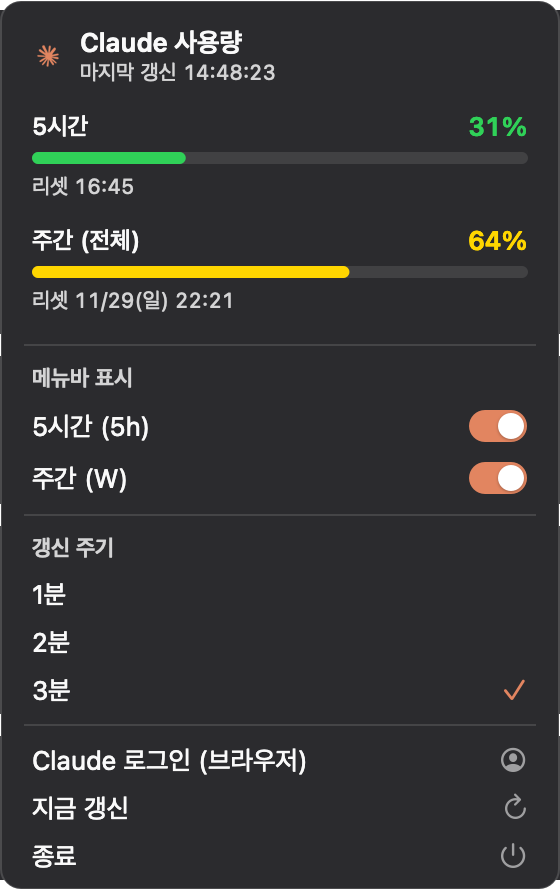
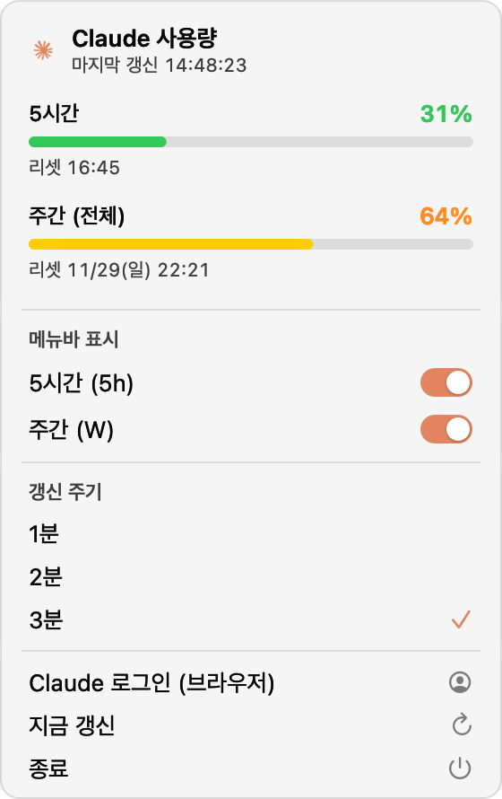

<div align="center">

# ClaudeUsageBar

**맥 메뉴바에서 Claude 사용량(5시간 · 주간)을 한눈에 보여주는 미니 앱**

<picture>
  <source media="(prefers-color-scheme: light)" srcset="docs/images/menubar-both-light.png">
  
</picture>

<sub>macOS 13+ · Swift 단일 파일 · 비공식 앱 · MIT</sub>

</div>

> [!NOTE]
> 이 저장소는 [dlitecomm/aimatters-ClaudeUsageBar](https://github.com/dlitecomm/aimatters-ClaudeUsageBar)를 바탕으로 **맥 버전의 디자인을 새로 만든** 포크입니다. Anthropic과 관계없는 **비공식** 앱입니다.

---

## 미리보기

### 메뉴바 표시 옵션

드롭다운의 **메뉴바 표시** 토글로 5시간(`5h`)과 주간(`W`) 줄을 각각 켜고 끌 수 있습니다. 최소 한 줄은 켜져 있어야 합니다.

| 둘 다 (기본) | 5시간만 | 주간만 |
| :---: | :---: | :---: |
|  |  |  |

### 사용률 색상 단계

| 🟢 50% 미만 | 🟡 50 – 79% | 🔴 80% 이상 |
| :---: | :---: | :---: |
|  |  |  |

### 라이트 · 다크 모드

메뉴바 모드에 맞춰 색이 자동으로 바뀝니다. `5h`는 흰색 ↔ 검정, `W`는 하늘색 ↔ 진한 파랑, Claude 마크는 두 모드 모두 주황입니다.

| 다크 | 라이트 |
| :---: | :---: |
|  |  |

### 드롭다운 메뉴

사용량 카드, 메뉴바 표시 토글, 갱신 주기, 로그인 · 갱신 · 종료를 한 메뉴에 담았습니다. 텍스트는 왼쪽, 아이콘 · 체크 · 토글은 오른쪽으로 정렬을 통일했습니다.

| 다크 | 라이트 |
| :---: | :---: |
|  |  |

<sub>모든 이미지는 앱의 실제 그리기 코드로 렌더링했습니다.</sub>

---

## 기능

- **메뉴바 게이지** — Claude 마크 + `5h` / `W` 두 줄 진행 바와 사용률 숫자
- **드롭다운 사용량 카드** — 5시간 · 주간(전체 / Sonnet / Opus 등) 사용률과 리셋 시각
- **표시 토글** — 메뉴바에 5시간, 주간, 또는 둘 다 표시 (설정은 재시작 후에도 유지)
- **갱신 주기** — 1분 / 2분 / 3분, 토큰 만료 시 자동 재발급
- **오래된 값 경고** — 갱신이 끊기면 메뉴바에 `⚠`, 메뉴에 "(오래된 값)" 표시
- **라이트 / 다크 모드** 자동 대응

> Claude 마크는 설치된 Claude 데스크톱 앱(`/Applications/Claude.app`)의 메뉴바 아이콘을 실행 시 읽어 옵니다. 저장소에는 로고 파일을 포함하지 않으며, 데스크톱 앱이 없으면 `✳`로 대신 표시합니다.

## 설치 (macOS)

```bash
git clone https://github.com/Astrum93/ClaudeUsageBar.git
cd ClaudeUsageBar/macos
./build.sh                 # Xcode Command Line Tools 필요
open CUBR-설치.command      # 또는 Finder에서 더블클릭
```

| 작업 | 방법 |
| --- | --- |
| 설치 / 재설치 | `CUBR-설치.command` 더블클릭 — `/Applications`에 복사, 로그인 시 자동 시작 등록, 바로 실행 |
| 삭제 | `CUBR-삭제.command` 더블클릭 — 앱 종료, 로그인 항목 해제, `/Applications`에서 제거 |
| 터미널 확인 | `/Applications/ClaudeUsageBar.app/Contents/MacOS/ClaudeUsageBar --once` |
| 로그인만 실행 | 위 경로에 `--login` |

### 첫 실행 · 로그인

처음 실행하면 메뉴바에 `✳로그인`이 뜹니다. 메뉴에서 **Claude 로그인 (브라우저)** 를 누르고 브라우저에서 승인하면 끝입니다.

- 앱은 **자기 전용 로그인**의 토큰만 갱신합니다. Claude Code의 로그인 토큰은 읽기만 하고 절대 갱신 · 수정하지 않습니다. 둘이 같은 토큰을 갱신하면 갱신 토큰이 회전될 때 서로를 무효화해서 Claude Code가 로그아웃되기 때문입니다.
- 로그인 정보는 키체인 `ClaudeUsageBar-auth`에 저장되며, Apple 정식 도구(`/usr/bin/security`)로 읽어 허용 창이 뜨지 않습니다.
- 갱신 토큰이 무효가 되면 메뉴바가 다시 `✳로그인`으로 바뀝니다. 한 번 더 로그인하면 됩니다.

<details>
<summary>토큰 우선순위 · 빌드 참고</summary>

- 토큰 우선순위: `~/.claude/cubr-token`(선택, `claude setup-token` 장기 토큰) → 앱 전용 로그인 → Claude Code 키체인 항목(읽기 전용, 유효할 때만)
- 빌드 시 "codesign이 키에 접근" 창이 뜨는 건 서명 키 쪽 승인이라 앱 사용과 무관합니다. `make-signing-cert.sh`로 자체 서명 인증서를 만들어 두면 재빌드해도 키체인 허용이 유지됩니다.

</details>

## 윈도우 (windows/)

윈도우 트레이 버전은 원본 저장소의 것을 그대로 포함하고 있으며, 이 포크의 디자인 변경은 적용되지 않았습니다.

<details>
<summary>윈도우 설치 방법</summary>

`windows` 폴더를 윈도우 PC로 복사한 뒤:

- **설치**: `CUBR-Install.bat` 더블클릭 — `%LOCALAPPDATA%\ClaudeUsageBar`에 복사, 시작 프로그램 등록, 설치된 앱 목록에 언인스톨 항목 등록, 즉시 실행
- **삭제**: 윈도우 설정 > 앱 > 설치된 앱에서 "ClaudeUsageBar" 제거, 또는 `CUBR-Uninstall.bat` 더블클릭
- **재설치**: `CUBR-Install.bat` 다시 실행

트레이 아이콘에 % 숫자가 색상(초록/노랑/빨강)으로 그려지고, 마우스 오버 툴팁 · 우클릭 메뉴로 상세를 확인합니다. 아이콘이 안 보이면 트레이의 숨김 아이콘(`^`)을 펼쳐 보세요. 토큰 위치는 `%USERPROFILE%\.claude\.credentials.json`입니다.

> 윈도우 스크립트는 실기기 테스트 전입니다. 문제가 생기면 트레이 아이콘 `!` 상태의 툴팁 메시지를 확인하세요.

</details>

## 동작 원리

1. 저장된 OAuth 자격증명(accessToken / refreshToken)을 읽습니다.
2. 만료됐으면 앱 전용 로그인의 토큰만 refresh해서 키체인에 저장합니다.
3. `GET https://api.anthropic.com/api/oauth/usage` (헤더 `anthropic-beta: oauth-2025-04-20`)를 호출합니다.
4. 응답의 `five_hour` / `seven_day*` 창별 `utilization`(%)과 `resets_at`을 표시합니다.

> [!WARNING]
> 이 사용량 엔드포인트는 문서화되지 않은 비공식 API라 형식이 바뀌거나 막힐 수 있습니다. 앱은 `utilization` 필드를 가진 창을 동적으로 파싱하므로 웬만한 변경에는 버팁니다.

## 크레딧 · 라이선스

- 원본: [dlitecomm/aimatters-ClaudeUsageBar](https://github.com/dlitecomm/aimatters-ClaudeUsageBar)
- 라이선스: [MIT](LICENSE) — 원저작자 표시를 유지합니다.
- "Claude"는 Anthropic의 상표이며, 이 프로젝트는 Anthropic과 관계가 없습니다.
